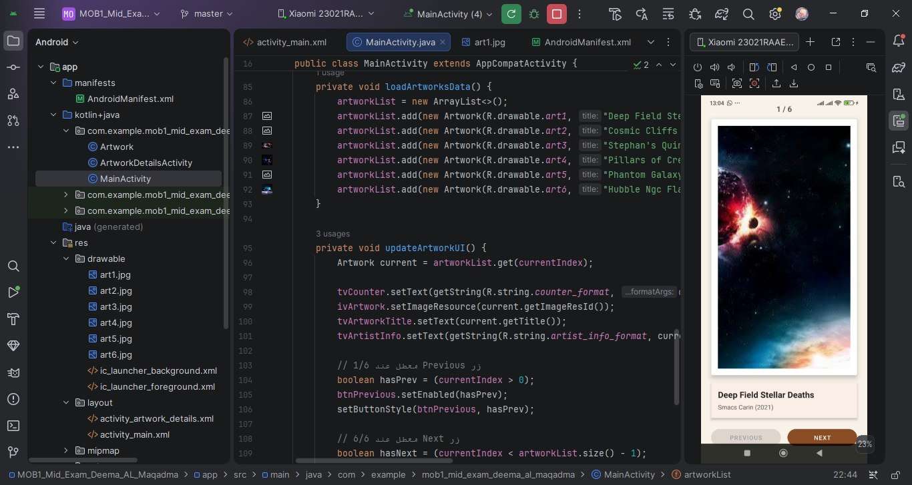
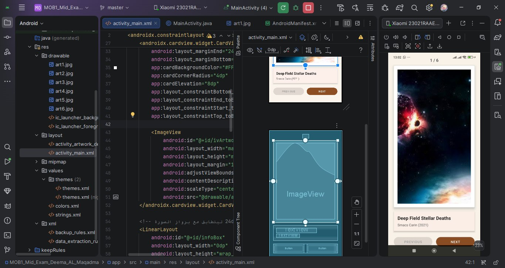
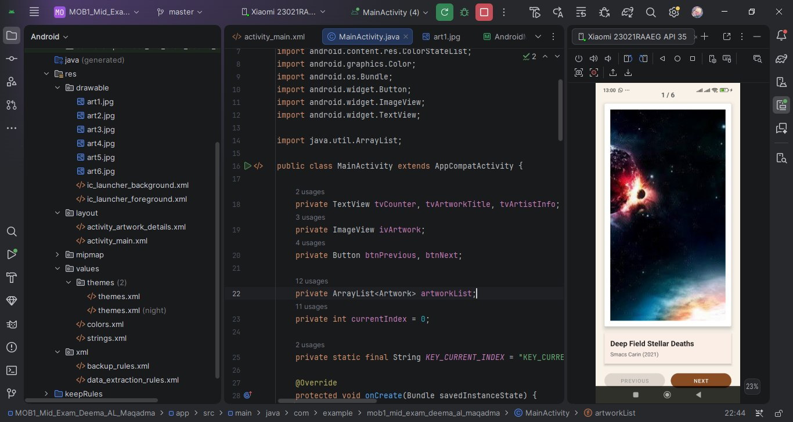
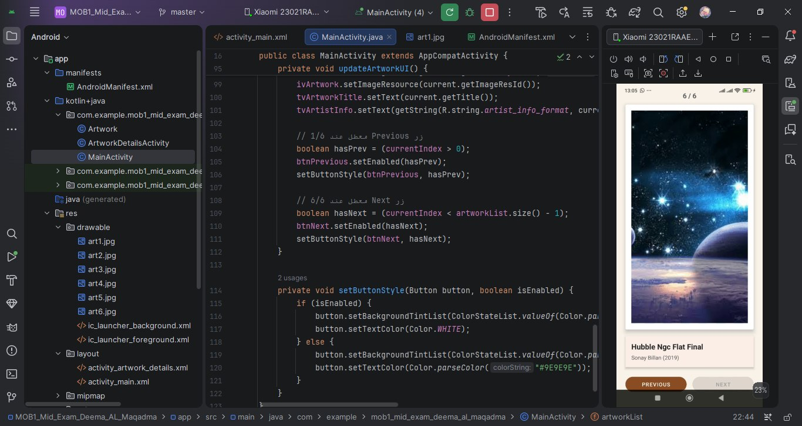
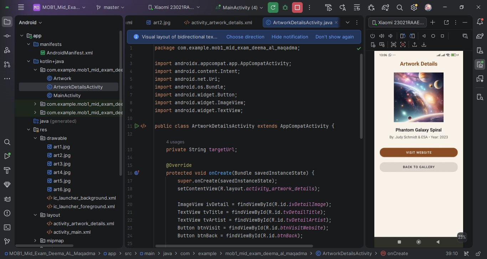
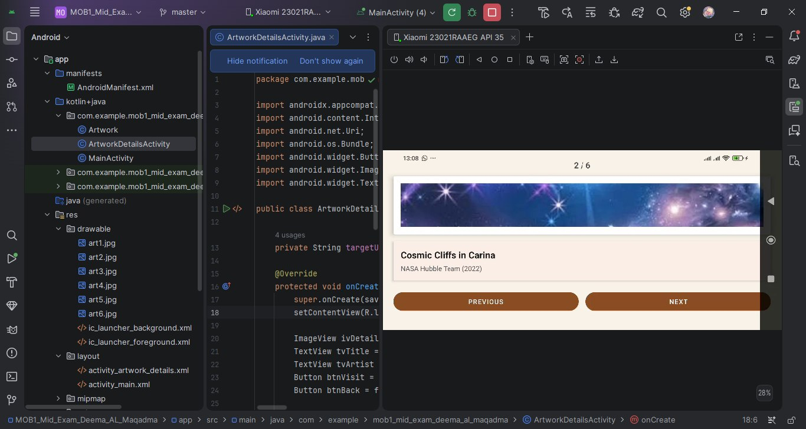

# ArtSpace - Android Practical Midterm Exam

**Course:** Mobile App Development 1 (ITNM3315)  
**Instructor:** Eng. Ibrahim O. I. Kaware  
**Student Name:** Deema AL-Maqadma  
**Institution:** Al-Aqsa University  
**Repository Name:** `Deema_AL-Maqadma_2320230766_ArtSpace`

---

## 📌 Project Overview
**ArtSpace** is a Native Android application built with **Java** and **XML**. It represents a digital interactive art and astronomy gallery displaying six high-resolution space artworks from the Hubble and James Webb Space Telescopes. The app features state-driven navigation, responsive card UI, configuration change management, and two-way Intent architectures (Explicit & Implicit).

---

## 📸 Development Evidence (Mandatory Screenshots)
<!-- جدول يعرض الصور الست مباشرة كمعاينة داخل صفحة المستودع -->

| 1. Initial State (1 / 6 - Prev Disabled) | 2. Mid Navigation (Both Buttons Active) |
| :---: | :---: |
|  |  |

| 3. Boundary State (6 / 6 - Next Disabled) | 4. Landscape Mode (State Preserved) |
| :---: | :---: |
|  |  |

| 5. Details Activity (Explicit Intent) | 6. External Browser (Implicit Intent) |
| :---: | :---: |
|  |  |

---

## 🔗 Official Submission Links

* **🎥 Demo Video (Google Drive):**  
  [Click Here to Watch the 3-Minute Demonstration Video](https://youtu.be/etXp0A9RJX0?si=NB4tY-YNrm2LGf_i)

* **📁 Development Evidence Folder (Google Drive):**  
  [Click Here to Open the Original Screenshots Folder](https://drive.google.com/drive/folders/1VQrfu4ZnZeL6dRSpMuIraWRx0RrQ7Dp0?usp=sharing)

---

## 🚀 Key Implemented Features

### 1. User Interface & Museum Framing (2 Marks)
- Designed with `ConstraintLayout` and `CardView` producing an authentic elevated museum picture frame.
- High-contrast typography with custom warm palettes (`#FAF4EC` canvas and `#FDEFEA` description container).
- Custom rounded pill buttons (`app:cornerRadius="26dp"`) displaying active (`#8D4E24`) and disabled (`#E0D7D0`) states.

### 2. State-Driven Gallery Navigation (2 Marks)
- Features a collection of 6 unique cosmic artworks loaded dynamically via an `Artwork` OOP data model.
- Responsive button state control:
  - `btnPrevious.setEnabled(false)` on first artwork (`1 / 6`).
  - `btnNext.setEnabled(false)` on final artwork (`6 / 6`).

### 3. Lifecycle & Orientation State Preservation (1.5 Marks)
- Overrides `onSaveInstanceState(Bundle outState)` saving `KEY_CURRENT_INDEX`.
- Restores gallery position in `onCreate(Bundle savedInstanceState)` during device rotation, ensuring zero data loss across configuration changes.

### 4. Explicit Intent & Data Transfer (2 Marks)
- The main `ImageView` is fully interactive (`setOnClickListener`).
- Launches `ArtworkDetailsActivity` passing metadata (`Title`, `Artist`, `Year`, `Image ID`, `URL`) via `intent.putExtra()`.
- Provides an intuitive `Back to Gallery` button terminating the activity via `finish()`.

### 5. Implicit Intent Integration (0.5 Marks)
- `Visit Website` button in details activity triggers an implicit `Intent(Intent.ACTION_VIEW, Uri.parse(url))` launching the system web browser safely.

---

## 🛠️ Environment Specifications
- **Programming Language:** Java (JDK 17)
- **UI Toolkit:** Declarative XML (ConstraintLayout, CardView, MaterialComponents)
- **Architecture:** OOP Model-View Architecture
- **Target Device:** Xiaomi Redmi Note 12 (Android 14/15)
